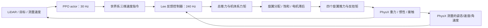

# 动作如何映射到四旋翼动力学

当前默认模式为 `rotor`。只有 reset 设置初始位置、姿态和速度；飞行期间只施加
旋翼力、反扭矩和电机轴转速，由 PhysX 推进机体位置、速度、姿态与角速度。
`kinematic` 是另外保留的对照模式，不参与默认训练或评估。



## 1. PPO 输出速度，控制器读取真实状态

原网络输出 Beta 分布的动作 `a_i ∈ [0,1]`，先变为目标方向坐标系中的速度：

`v_local = (2 a - 1) × 2 m/s`。

原 PPO 的 `vec_to_world` 将它转到世界坐标，环境再把世界速度分量限制到 ±2 m/s。
默认评估使用 Beta 均值，训练采样动作。导航网络读取的速度是 PhysX 测量值，
不再将速度指令冒充实际速度。目标参考坐标在 reset 固定为初始目标的水平朝向，
LiDAR 与原版一样只跟随机体 yaw，不跟随 roll/pitch。

## 2. 速度到推力方向与总推力

原 NavRL 的 `VelController(yaw_control=False)` 调用 LeePositionController。
它将目标位置默认设为当前位置，因此这里没有位置误差项；目标加速度默认零。

`a_des = K_v (v_cmd - v_measured) + [0, 0, 9.81]`，其中 `K_v=[2.2,2.2,2.2]`。

`b3_des = a_des / ||a_des||` 指定期望机体竖轴，结合当前 yaw 构造期望姿态 `R_des`。
`R` 是测量的机体到世界旋转，机体 z 轴为 `R e3`。

`T = m a_des · (R e3)`。

例如要向前加速，期望推力方向向前倾斜；要刹车，则向后倾斜。水平推力来自
倾斜后的旋翼推力，不通过直接施加世界系水平推进力来伪造。

## 3. 姿态误差到机体系力矩

`e_R = vee((R_desᵀ R - Rᵀ R_des)/2)`。

PhysX 返回世界系角速度，先通过 `ω_body = Rᵀ ω_world` 转换。

`τ = -K_R e_R - K_ω ω_body`。

`K_R=[0.7,0.7,0.035]`，`K_ω=[0.1,0.1,0.025]`，与原 Hummingbird 控制器配置一致。
原实现先计算角加速度再经惯量与 mixer，约去中间的惯量归一化后就是上述力矩。
这里复现原实现的反馈项，不额外添加原版没有的陀螺补偿项。

## 4. 总推力/力矩到四个旋翼

Hummingbird 是十字布局，臂长 0.17 m。编号与 USD、YAML 一致：

| 旋翼 | 机体系位置 | 角速度符号 | 反扭矩 z 符号 |
|---|---|---|---|
| 0 | +X | − | + |
| 1 | +Y | + | − |
| 2 | −X | − | + |
| 3 | −Y | + | − |

记单旋翼推力为 `f_i`，`k=k_M/k_F≈0.016 m`：

```text
τx = 0.17 (f1 - f3)
τy = 0.17 (f2 - f0)
τz = k (f0 - f1 + f2 - f3)
T  = f0 + f1 + f2 + f3
```

解上述分配矩阵得到四个期望推力，再限制在各电机的 `[0,f_max]`。不可实现的
力矩/推力请求会饱和，记录在 `actuator_saturated`；不会强行修改机体运动来满足指令。

## 5. 电机、旋翼与 PhysX

参数直接读取原 YAML：`k_F=8.54858e-6 N/(rad/s)²`，
`k_M=1.3677728816e-7 Nm/(rad/s)²`，最大转速 `838 rad/s`。

`f_i=k_F Ω_i²`，`q_i=-direction_i k_M Ω_i²`。

电机转速不是瞬间变化。复现原 RotorGroup 的归一化转速状态：

```text
s_target = sqrt(f_cmd / f_max)
s_next   = s + α (s_target - s)
Ω        = direction × Ω_max × s_next
```

原 `tau_up=tau_down=0.43` 实际是每步插值系数，并非 0.43 秒。原配置步长为
16 ms；本迁移用 `α=1-(1-0.43)^(dt_physics/0.016)` 保留对应的时间响应。
当前 `dt_physics=1/240 s`，每个 `1/30 s` 导航动作执行 8 个物理步，控制器也在
每个物理步读取状态并重新计算。

推力以旋翼各自局部 +Z 方向施加到相应 link，力臂自动产生滚转/俯仰力矩。
各旋翼反扭矩转到世界坐标后施加在 base_link；关节轴转速同步至电机状态。
PhysX 根据资产中的质量、惯量和关节约束积分运动，包括重力和接触响应。
运动满足典型关系：`m v_dot = R e3 Σf_i - m g e3 + F_contact`，
`J ω_dot + ω×(Jω) = τ`（实际使用的是 USD 多 link 质量/惯量）。

USD 机体质量 0.680 kg，四个旋翼各 0.009 kg，总计 0.716 kg。base_link 的对角
惯量为 `[0.007,0.007,0.012] kg·m²`，旋翼 link 还贡献自身与分布惯量。
理想水平悬停每旋翼约 1.75599 N。reset 时以悬停电机转速初始化，随后不锁定高度。

## 6. 已完成的验证与范围

- 与未修改的原 Lee 控制器比较 100 个状态/速度输入，最大推力误差约 `2.08e-6 N`。
- 与未修改的原 RotorGroup 比较 100 次电机更新，最大数值误差约 `6.59e-7`。
- 停止施力后，0.2 秒自由落体测得 `vz≈−1.962 m/s`，证明重力正常参与运动。
- 6 秒理想悬停漂移约 `3.85e-6 m`；这只代表无扰动的理想数值模型。
- 1 m/s 前进指令在 3 秒时跟踪到约 `0.99997 m/s`，峰值倾角约 `10.58°`。
- 零速度制动距离约 `0.454 m`，峰值反向俯仰约 `−10.58°`。
- Y 方向速度、0.5 m/s 爬升、12° 横滚扰动恢复均通过。
- 原发布策略在同一静态场景的 360 步评估中到达目标 2 次，未触发碰撞/失稳判定。
- 使用动力学 rollout 完成 2 次 PPO 更新，各 32 步，参数有限且确实发生变化。

这是原 NavRL 默认单机旋翼动力学链路，不是高保真气动/电气模型。原代码默认
阻力系数实际初始化为零、电机噪声乘零；当前也保持这一默认设置。没有额外
声称实现电池、电机电气细节、风场、地效、桨叶流场或多机下洗。
多环境随机化和完整动态障碍任务仍是另外的迁移层。少量固定场景结果不等于
论文成功率或新训练策略已收敛。

## 7. 强化学习应在哪一层训练

推荐保持三维速度动作，但训练 rollout 必须经过以上控制器和动力学闭环。
PPO 因而能从奖励中学到惯性、响应延迟、刹车距离以及动作饱和的影响。
执行映射是依赖真实状态的反馈控制，不是一个可以事后无损替换的静态函数。

简单运动学环境可用于调试、课程学习或预训练；最终应在动力学环境继续训练并
评估，必要时随机化质量、惯量、电机响应、延迟、风扰和传感器噪声。

直接让 RL 输出四个电机动作也可行，但任务同时包含飞行稳定和导航；至少需要
增加姿态、角速度等观测，改变三维动作头、重做奖励/课程，并从头训练低层控制。
更常见的另一折中是 RL 输出总推力和角速度，由传统角速度环与 mixer 执行。
对当前 NavRL 迁移与导航目标，没有必要先改变已经验证的速度动作接口。
