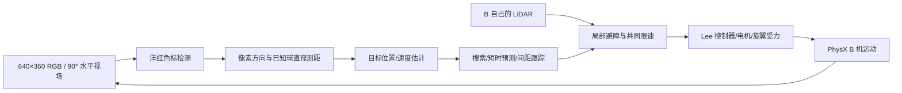

# 双无人机视觉搜索与跟踪 demo

这是第一版 **1 个目标 A + 1 个跟踪者 B**，保留迁移后的旋翼动力学。
A 使用官方 NavRL PPO 权重执行随机目标导航；B 使用 RGB 色标检测与传统跟踪控制，
目前没有训练 B 的视觉强化学习策略。

## 启动

```bash
cd /home/wj/桌面/无人机/TRACE_baseline_foundation/upstream/NavRL/isaac6-training
./run_tracking_demo.sh --gui --loop --realtime
```

默认选择已有的 VNC 桌面 `:3`。主视口是 Isaac Sim 工业场景的实际 RTX 渲染；
浮动窗口显示 **B 相机真实 RGB、绿色检测框、SEARCH / TRACK / COAST 状态**，
并显示两机实际速率、共同速度上限，以及仅用于评估的真实间距。
A 有洋红色识别球，B 有蓝色识别球；绿色小球表示 A 当前随机目标。

有限时长评估与录制：

```bash
./run_tracking_demo.sh --seconds 45 --seed 7 \
  --report artifacts/tracking_demo_report.json
./run_tracking_demo.sh --gui --seconds 45 --seed 7 \
  --record-dir artifacts/tracking_frames --record-every 30 \
  --report artifacts/tracking_visual_report.json
/home/wj/miniconda3/envs/navrl/bin/python make_replay.py \
  artifacts/tracking_frames artifacts/navrl6_tracking_replay.gif --interval-ms 1000
```

切换到程序化森林场景（不需要额外下载 USD 资产）：

```bash
./run_tracking_demo.sh --gui --scene forest --seconds 60 \
  --record-dir artifacts/forest_tracking_frames \
  --report artifacts/forest_tracking_report.json
/home/wj/miniconda3/envs/navrl/bin/python make_replay.py \
  artifacts/forest_tracking_frames artifacts/forest_tracking.gif --interval-ms 200
```

森林中的树干有碰撞体，树冠参与相机遮挡；树冠暂不参与物理碰撞，避免把视觉演示变成
密集的不可飞行体积。A/B 仍然使用同一套旋翼动力学、LiDAR、RGB 相机和跟踪器。

`--seed` 改变 A 的后续随机目标；第一段统一飞往 `[9,-1,2] m`，然后在大厅安全
范围内抽取目标。接近目标后直接切换目标，整个过程不重置或瞬移无人机。
360° LiDAR 在每段固定目标参考系中重新排列，以保持原 NavRL 的输入语义。

## 两机速度与物理公平性

- 默认共同速度指令上限为 **三维向量范数 2 m/s**，不是逐轴各 2 m/s。
- 两机使用相同 Hummingbird USD、0.716 kg 质量、惯量、推力上限、控制增益及电机响应。
- 两机先在同一个物理子步施加旋翼受力，再共同推进一次世界，物理 240 Hz。
- 导航动作 30 Hz；B 的相机、检测与跟踪更新 10 Hz。
- 这表示相同飞行能力；实际瞬时速率随转弯、制动与跟踪距离变化。物理响应可能有微小超调，
  不通过强制写入实际速度来消除超调。

B 默认在 `[-9.2,-3.919,2] m`，距离 A 的初始位置恰为 10 m。B 相机初始朝向场外，
并未通过已知 A 坐标预先对准。`--initial-distance` 支持 6–10 m，
`--speed-limit` 支持两机共同的 0–2 m/s，`--follow-distance` 默认 3.5 m。

## B 的视觉闭环



相机使用理想稳定云台，安装点跟随 B 自己的位置，云台角速度有限制。
识别球半径为 0.18 m；使用相机内参、图像边界的角直径和已知球尺寸估计距离，
不读取目标深度、实例分割 ID、目标真实位姿或目标速度。

`visual_tracker.py` 不导入 Isaac Sim，不接收 A 的状态。它只接收 RGB 检测、B 自己
的位置、相机位姿和时间；B 的 LiDAR 另用于局部避障。
真实 A 坐标仅在 runner 的评估部分计算测距误差、机间距和飞行安全指标。

- `SEARCH`：初始悬停并扫描。丢失后先在上次方向附近搜索，再做全向扫描。
- `TRACK`：用 alpha-beta 滤波估计目标运动，速度前馈加间距反馈产生 B 的期望速度。
- `COAST`：没有检测时只作最多 1.2 秒的短时运动预测，再进入搜索；不会持续追踪不可见真值。

同速追踪不能保证追上无限直线远离的目标。本 demo 的 A 在有限大厅中随机转向，
B 可以在目标转弯时接近；搜索成功与持续可见率应通过评估衡量。

## 验证

```bash
/home/wj/isaacsim/python.sh check_visual_tracker.py
/home/wj/isaacsim/python.sh verify_dynamics.py
# 隐藏识别球：视觉检测应为零，B 不能凭真实坐标发现目标
./run_tracking_demo.sh --seconds 10 --hide-target \
  --report artifacts/tracking_hidden_marker.json
# 相机中断：应经过 TRACK → COAST → SEARCH，再尝试重新发现
./run_tracking_demo.sh --seconds 35 --camera-dropout-start 20 \
  --camera-dropout-duration 2 --report artifacts/tracking_dropout_report.json
```

JSON 报告记录首次发现时间、视觉检测比例、末段间距、共同指令限速、实际速率峰值、
A 到达的随机目标、失稳/碰撞净空判定及任务验收。JSONL 记录每个相机帧的检测结果、
估计误差与轨迹，真实状态字段明确标记 `evaluation_only`。

持续至少 20 秒的普通评估要求成功发现目标、超过半数相机帧有检测、末 10 秒平均
间距小于 6 m、A 至少到达 2 个目标，并通过动力学时钟和飞行检查。
隐藏色标对照则要求没有任何视觉发现。短运行仅验证启动和飞行链路。

本机场景、种子 7 的 45 秒 GUI 验证结果（`artifacts/tracking_visual_report.json`）：

| 指标 | 结果 |
|---|---|
| 初始机间距 | 10 m |
| 首次视觉发现 | 3.2 s |
| 有目标检测的相机帧比例 | 79.8%（包含初始搜索与丢失阶段） |
| 最后 10 秒平均间距 | 3.81 m |
| A 到达的随机目标 | 10 个 |
| 碰撞净空/失稳判定 | 均未触发 |

在另一次 35 秒运行中，第 20–22 秒将相机输入置黑，B 于 20.0 秒进入 COAST、
21.1 秒进入 SEARCH、22.4 秒重新 TRACK。隐藏色标的 10 秒对照没有任何检测。
原单机动力学回归与像素/跟踪器检查均通过，汇总为 `artifacts/tracking_validation.json`。
这些是已知色标与固定场景的功能验证，不代表无色标视觉识别或跨场景跟踪成功率。

## 下一阶段

当前是受控色标条件下的功能基线；不等同于无色标无人机检测器，也不是多智能体
强化学习训练环境。之后可依次替换为无人机视觉检测/重识别、RGB 特征与 LiDAR 融合策略、
搜索/跟踪奖励及训练、更多跟踪者和多环境训练。保留本版的无目标真值控制接口与同速约束，
可以用同一评估方式比较新算法。
